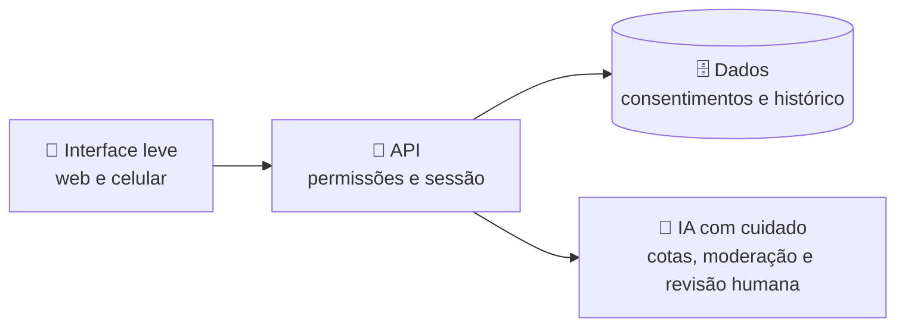

# Olá, eu sou o Daniel 👋

**Daniel Pires Francisco** · *Daniel P Francisco*
Presidente da **LAIFT** · Graduando em **Farmácia** (UNINASSAU Salvador)
Construo **plataformas de ensino em saúde com inteligência artificial** 🧪🤖

📍 Salvador, Bahia, Brasil · ✉️ contato via LinkedIn

---

## 🧭 Escolha a sua trilha

| Você é… | Comece por aqui |
|---|---|
| 🎒 **Estudante** | [Plataforma da LAIFT](https://laift.com.br) e o [Quiz de Farmacologia](https://github.com/Diretoria-DPF/Farmacologia-basica-quiz) |
| 🧑‍🔬 **Curioso de laboratório** | [Laboratório Virtual](https://github.com/Diretoria-DPF/laboratorio-virtual) |
| 🏥 **Gestão em saúde** | [SIAT-BR](https://github.com/Diretoria-DPF/siat-br-prototipo): protótipo de adesão terapêutica |
| 🤝 **Quer trabalhar comigo** | [Serviços](https://dpflabs.com/servicos/) e [Sobre](https://dpflabs.com/sobre/) |

---

## 🗺️ Mapa de projetos

<table>
<tr>
<td width="50%" valign="top">

### 🧬 plataforma-membros
A plataforma da LAIFT: **governança da liga** e um **ambiente de aprendizagem** com clínica virtual, laboratório, atlas 3D, quizzes e check-in por QR Code.
[Conhecer →](https://github.com/Diretoria-DPF/plataforma-membros)

</td>
<td width="50%" valign="top">

### 🧪 laboratorio-virtual
Simulações de **química do cotidiano** e **toxicologia**: monte o experimento, veja a reação e aprenda o porquê.
[Experimentar →](https://github.com/Diretoria-DPF/laboratorio-virtual)

</td>
</tr>
<tr>
<td valign="top">

### 💊 Farmacologia-basica-quiz
Quiz de **farmacologia básica** com perguntas por tópico, feedback imediato e uma pitada de jogo.
[Jogar →](https://github.com/Diretoria-DPF/Farmacologia-basica-quiz)

</td>
<td valign="top">

### 📲 sistema-checkin-academico
**Check-in de eventos acadêmicos** por QR Code, pensado para ligas e congressos.
[Ver →](https://github.com/Diretoria-DPF/sistema-checkin-academico)

</td>
</tr>
<tr>
<td colspan="2" valign="top">

### 🏥 siat-br-prototipo
Protótipo desenvolvido para a participação no **32º Prêmio Jovem Cientista (CNPq, 2026)**: um olhar de **telefarmácia e adesão terapêutica** para apoiar a gestão da saúde pública, com **dados totalmente simulados**.
[Explorar →](https://github.com/Diretoria-DPF/siat-br-prototipo)

</td>
</tr>
</table>

---

## 🧩 Como as peças se encaixam

🎮 <strong>O que eu valorizo ao construir</strong> (clique para abrir)

- **Aprender fazendo:** simulações, casos fictícios e jogos que explicam o porquê.
- **Segurança desde o desenho:** perfis, permissões e privacidade pensados desde o começo.
- **IA com responsabilidade:** limites, moderação e revisão humana.
- **Clareza:** linguagem simples para quem está estudando e quem está decidindo.

🌱 <strong>Em que estou trabalhando</strong>

Novas formas de **estudar farmacologia e toxicologia com IA**, a evolução da plataforma da LAIFT e a continuidade do SIAT-BR.

---

🔎 Pesquisando por mim? **Daniel Pires Francisco** · **Daniel P Francisco** · [dpflabs.com](https://dpflabs.com)

Conteúdo educativo. Nada aqui substitui o acompanhamento de profissionais de saúde habilitados.

