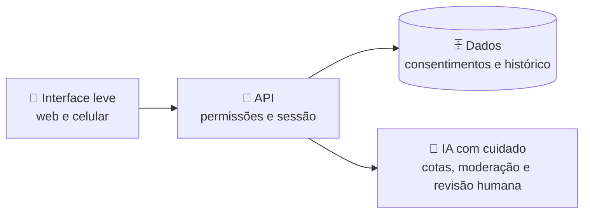

<picture>
  <source media="(prefers-color-scheme: dark)" srcset="assets/banner-dark.svg">
  <source media="(prefers-color-scheme: light)" srcset="assets/banner-light.svg">
  
</picture>

**Presidente da LAIFT** · Graduando em **Farmácia** (UNINASSAU Salvador) · *também conhecido como Daniel P Francisco*

📍 Salvador, Bahia, Brasil · ✉️ dpires292@gmail.com

---

## 👋 Olá!

Eu construo **plataformas de ensino em saúde com inteligência artificial**: simuladores, laboratórios virtuais e jogos que ajudam estudantes a entender farmacologia e toxicologia na prática, com segurança.

> [!NOTE]
> Todo o conteúdo aqui é **educativo**. Nada substitui o acompanhamento de profissionais de saúde habilitados.

## 🧭 Escolha a sua trilha

| Você é… | Comece por aqui |
|---|---|
| 🎒 **Estudante** | [Quiz de Farmacologia](https://diretoria-dpf.github.io/Farmacologia-basica-quiz/) · [Plataforma da LAIFT](https://laift.com.br) |
| 🧑‍🔬 **Curioso de laboratório** | [Laboratório Virtual](https://diretoria-dpf.github.io/laboratorio-virtual/) · [Simulador de Físico-Química](https://diretoria-dpf.github.io/laift-quimica-simulador/) |
| 🏥 **Gestão em saúde** | [SIAT-BR](https://github.com/Diretoria-DPF/siat-br-prototipo): protótipo de adesão terapêutica |
| 🤝 **Quer trabalhar comigo** | [Serviços](https://dpflabs.com/servicos/) · [Sobre mim](https://dpflabs.com/sobre/) |

## 🗺️ Mapa de projetos

<table>
<tr>
<td width="50%" valign="top">

### 🧪 laboratorio-virtual
Simulações de **química do cotidiano** e **toxicologia**: monte o experimento, veja a reação e aprenda o porquê.
[▶ Experimentar](https://diretoria-dpf.github.io/laboratorio-virtual/) · [Código](https://github.com/Diretoria-DPF/laboratorio-virtual)

</td>
<td width="50%" valign="top">

### 💊 Farmacologia-basica-quiz
Quiz de **farmacologia básica** com feedback imediato e uma pitada de jogo.
[▶ Jogar](https://diretoria-dpf.github.io/Farmacologia-basica-quiz/) · [Código](https://github.com/Diretoria-DPF/Farmacologia-basica-quiz)

</td>
</tr>
<tr>
<td valign="top">

### ⚗️ laift-quimica-simulador
Simulador interativo de **físico-química** e **toxicologia**.
[▶ Experimentar](https://diretoria-dpf.github.io/laift-quimica-simulador/) · [Código](https://github.com/Diretoria-DPF/laift-quimica-simulador)

</td>
<td valign="top">

### 📲 sistema-checkin-academico
**Check-in de eventos acadêmicos** por QR Code, pensado para ligas e congressos.
[Código](https://github.com/Diretoria-DPF/sistema-checkin-academico)

</td>
</tr>
<tr>
<td colspan="2" valign="top">

### 🏥 siat-br-prototipo
Protótipo desenvolvido para a participação no **32º Prêmio Jovem Cientista (CNPq, 2026)**: um olhar de **telefarmácia e adesão terapêutica** para apoiar a gestão da saúde pública, com **dados totalmente simulados**.
[Explorar](https://github.com/Diretoria-DPF/siat-br-prototipo)

</td>
</tr>
<tr>
<td colspan="2" valign="top">

### 🧬 Plataforma LAIFT (no ar)
O ambiente completo da liga: governança, clínica virtual, laboratório, atlas 3D e quizzes. O código é privado; para uma **demonstração guiada**, escreva para dpires292@gmail.com.
[Acessar laift.com.br](https://laift.com.br)

</td>
</tr>
</table>

## 🛠️ Tecnologias

## 🧩 Como as peças se encaixam

🎮 <strong>O que eu valorizo ao construir</strong>

- **Aprender fazendo:** simulações, casos fictícios e jogos que explicam o porquê.
- **Segurança desde o desenho:** perfis, permissões e privacidade pensados desde o começo.
- **IA com responsabilidade:** limites, moderação e revisão humana.
- **Clareza:** linguagem simples para quem estuda e para quem decide.

🕰️ <strong>Linha do tempo</strong>

- **2026:** Presidente da LAIFT, liderando equipes e soluções de ensino em saúde com IA.
- **2026:** protótipo SIAT-BR, desenvolvido para o 32º Prêmio Jovem Cientista (CNPq).
- **2026:** plataforma da LAIFT no ar, com ambiente de aprendizagem.
- **Sempre:** estudando Farmácia na UNINASSAU Salvador.

🌱 <strong>Em que estou trabalhando</strong>

Novas formas de **estudar farmacologia e toxicologia com IA**, a evolução da plataforma da LAIFT e a continuidade do SIAT-BR.

<!-- Cartões de estatísticas do GitHub: ativar quando houver mais atividade pública.
 -->

---

🔎 Pesquisando por mim? **Daniel Pires Francisco** · **Daniel P Francisco** · [dpflabs.com](https://dpflabs.com)

